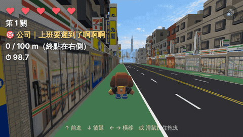

# 行人地獄

**▶ 立即遊玩：<https://jingjeryen.github.io/game-pedestrian-hell/>**



你是一個台灣行人。在「行人地獄」的街頭活下去，能走多遠就走多遠。
3D 無盡跑酷：汽車、機車、違停、腳踏車都在找你麻煩，斑馬線上車不會讓你。

## 操作

- ↑ 前進／↓ 後退／← → 橫移（也可以用 WASD）
- 手機或滑鼠：按住螢幕拖曳＝虛擬搖桿
- M：音效開關

## 本機開發

```sh
npm install
npm run dev     # 開發伺服器
npm run build   # 型別檢查＋產出正式版
```

設計決策與里程碑見 [DESIGN.md](DESIGN.md)。
